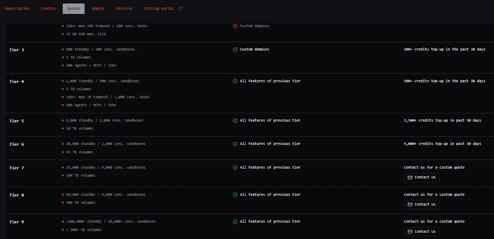
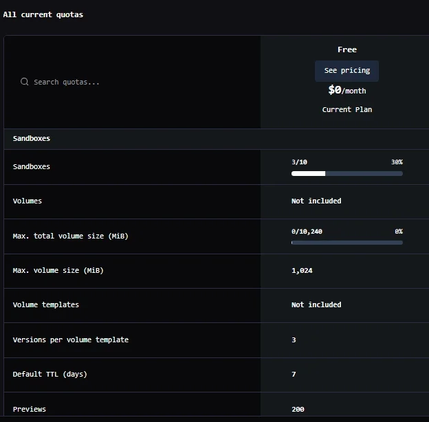
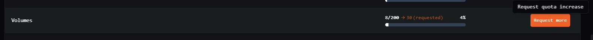
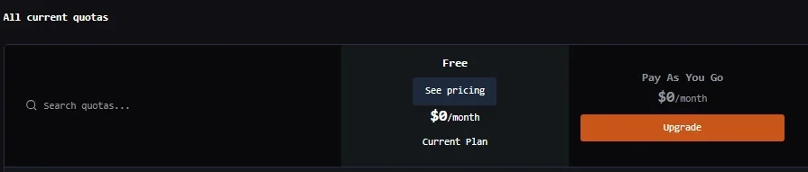
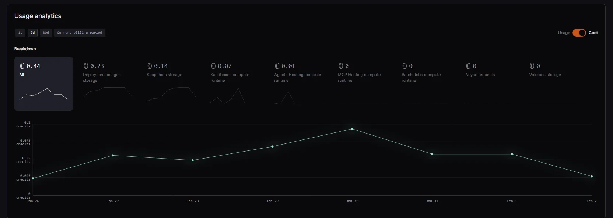

import BuildLimits from '/snippets/limits/build-limits.mdx';
import RateLimits from '/snippets/limits/rate-limits.mdx';
import TierAccount from '/snippets/limits/tier-account.mdx';
import TierBuilds from '/snippets/limits/tier-builds.mdx';
import TierEphemeralVolumes from '/snippets/limits/tier-ephemeral-volumes.mdx';
import TierSandboxFeatures from '/snippets/limits/tier-sandbox-features.mdx';
import TierSandboxes from '/snippets/limits/tier-sandboxes.mdx';
import TierStorage from '/snippets/limits/tier-storage.mdx';
import TierWorkloads from '/snippets/limits/tier-workloads.mdx';

The Blaxel Console provides detailed analytics for you to monitor account usage. You can also see your account's current quotas, and request an increase in quotas if required.

## Quotas

### Quota tiers

Blaxel has a quota tiering system that unlocks higher limits and features on the platform as your tier progresses.

Higher tiers have access to higher limits such as more standby/concurrent sandboxes, more concurrent jobs, higher sandbox and volume sizes, longer sandbox TTLs. They also have access to gated features such as custom domains, dedicated IPs and more.

You can see the [limits and features of each tier](https://app.blaxel.ai/account/quotas) in the **Quotas** tab.

- Click the workspace name at the bottom left of the Blaxel Console.
- In the sub-menu, click **Account**.
- Click the **Quotas** tab.



#### How tiers are calculated

Your current tier is evaluated continuously based on your **30-day top-up volume**. This is the total amount of real funds added to your Blaxel wallet via manual or automated top-ups over the trailing 30 days.

**Top-ups are not flat fees**: Funds added to meet a tier requirement are deposited directly into your account balance. These funds are subsequently used to pay for your standard compute and storage consumption.

**Promotional credits do not unlock tiers**: Promotional credits (such as startup program grants) and previously accumulated balances automatically apply toward your active infrastructure costs. However, they do not count toward the 30-day top-up volume required to unlock or maintain a quota tier.

#### Maintaining your tier

Because tier eligibility relies on a rolling 30-day window, your tier will automatically adjust if your top-up volume decreases. If your 30-day top-up volume falls below your current tier's threshold, your workspace will be downgraded, which may result in blocked resource creation if you exceed the lower tier's limits.

To prevent service disruptions and maintain your quotas without manual intervention, you can configure **Auto top-up** in the Billing section of your Console.

#### Default quotas of each tier

The tables below list the default quotas of each tier. Quotas apply to your whole account, across all its workspaces. A [quota increase](#manually-request-a-quota-increase) can raise your quotas above these defaults. See [pricing and limits](/pricing) for the other platform limits.

<AccordionGroup>
  <Accordion title="Sandboxes">
    <TierSandboxes />
  </Accordion>
  <Accordion title="Previews, snapshots and schedules">
    <TierSandboxFeatures />
  </Accordion>
  <Accordion title="Volumes and images">
    <TierStorage />
  </Accordion>
  <Accordion title="Ephemeral volumes">
    The total ephemeral volume size counts the ephemeral volumes of every sandbox in your account that isn't terminated, including sandboxes in standby.

    <TierEphemeralVolumes />
  </Accordion>
  <Accordion title="Agents, MCP servers and jobs">
    <TierWorkloads />
  </Accordion>
  <Accordion title="Account">
    <TierAccount />
  </Accordion>
</AccordionGroup>

#### Rate limits

These limits don't depend on your tier.

<RateLimits />

On sandbox creation, a rate limit and a quota both answer HTTP `429`. Read the `code` field of the error to tell them apart:

- `WORKSPACE_RATE_LIMIT_EXCEEDED` is a rate limit. Nothing was created, and the limit clears as earlier creations finish: send the same request again after a short wait.
- `QUOTA_EXCEEDED` is a quota. Sending the same request again returns the same error until you delete resources or your quota is raised. Keep the sandboxes you run at once under your quotas instead, and [read them through the API](#read-quotas-through-the-api) before a large run.

A `429` with the code `RATE_LIMITED` isn't a quota either: too many requests came from your IP address, and the network edge refused this one before the API saw it. Wait for the number of seconds in the `Retry-After` header, then retry with backoff.

#### Image build quotas

Blaxel is moving workspaces to a build queue. On the build queue, image builds aren't limited by a count. Your account's builds together, queued and running, may reserve up to its build quotas. A build gets the vCPUs of its memory size, the same as a [sandbox](/pricing#sandbox-resources), and the default build size fits the number of builds shown in the last column.

<TierBuilds />

<BuildLimits />

- A build that doesn't fit waits in the queue, with no error, until earlier builds finish.
- A build that needs more than your account's build quota on its own fails at once. Lower its sizes in the project's build configuration.
- When your queued builds already reserve more than the queue allows, uploading a new build context (an SDK image build, or `bl deploy`) fails with HTTP `429`. This clears as builds finish: retry later. It isn't a quota you have to raise.

Workspaces not yet on the build queue use the older build path's limit on builds running at once instead, in the last rows of the table above.

### Quota usage

Blaxel also lets you view and manage quotas associated with your account.

Quotas for your account are listed in the **All current quotas** section.



This section provides details on quotas for:

- Deployed sandboxes, agents, MCP servers, model APIs, policies, triggers, and jobs
- Sandboxes: volumes, volume templates, default TTL, previews, volume sizes and versions
- Jobs: maximum parallel executions, maximum concurrent tasks
- Workspaces: users, service accounts, integrations, custom domains, revisions, timeouts

### Read quotas through the API

You can read your quotas, how much of each is in use and the sandbox creation limit through the API, for example to size a large run or to slow down before it reaches a quota. Any credential of the workspace can read them, service account API keys included: `GET https://api.blaxel.ai/v0/workspaces/{workspace}/quotas`. A credential with no role in that workspace gets a `403` error with `WORKSPACE_ACCESS_DENIED`.

```bash
# A user login (`bl login`), a personal API key or a service account API key
TOKEN=$(bl token)
WORKSPACE=my-workspace
curl -s -H "Authorization: Bearer $TOKEN" \
  "https://api.blaxel.ai/v0/workspaces/$WORKSPACE/quotas"
```

```json
{
  "workspace": "my-workspace",
  "account": "<accountId>",
  "quotas": [
    {"resourceType": "ephemeral_volume_total_max_size", "limit": 163840, "used": 40960},
    {"resourceType": "memory", "limit": 8192},
    {"resourceType": "sandboxes", "limit": 800, "used": 312}
  ],
  "rateLimits": [
    {"name": "sandbox_creation_concurrency", "limit": 100}
  ]
}
```

- `quotas`: one entry per quota of your account, sorted by `resourceType`. Quotas apply to the whole account, so `limit` and `used` cover all of its workspaces.
  - `resourceType`: the quota, such as `sandboxes`, `memory`, `ephemeral_volume_max_size`, `ephemeral_volume_total_max_size`, `image_total_max_size`, `volumes` or `volume_max_size`. Sizes are in MB.
  - `limit`: the quota that applies to your account, including any increase.
  - `used`: how much is in use now, in the unit of `limit`. It's left out for quotas with nothing to add up, such as per-sandbox maximums (`memory`, `ephemeral_volume_max_size`) and durations (`sandbox_ttl`).
- `rateLimits`: limits on this workspace alone. `sandbox_creation_concurrency` is how many sandbox creations can be in progress at once in the workspace, counted separately in each region, including a raised limit. The number in progress isn't returned. See [rate limits](#rate-limits).

#### Account quotas with a user login

`GET https://api.blaxel.ai/v0/quotas/account/{accountId}` also lists your account's quotas. It takes a user login or a personal API key: a service account API key gets a `400` error, and partner platform tokens can't read it either. It returns `used: 0` for quotas it doesn't count, including `ephemeral_volume_total_max_size`, so read the workspace endpoint above for that one.

```bash
TOKEN=$(bl token)
WORKSPACE=my-workspace
ACCOUNT_ID=$(curl -s -H "Authorization: Bearer $TOKEN" -H "X-Blaxel-Workspace: $WORKSPACE" \
  "https://api.blaxel.ai/v0/workspaces/$WORKSPACE" | jq -r .accountId)
curl -s -H "Authorization: Bearer $TOKEN" -H "X-Blaxel-Workspace: $WORKSPACE" \
  "https://api.blaxel.ai/v0/quotas/account/$ACCOUNT_ID"
```

Snapshots count against two quotas, both numbers of snapshots: `sandbox_snapshots` and `sandbox_snapshots_per_sandbox`, the **Snapshots** and **Snapshots per sandbox** columns of the [default quotas](#default-quotas-of-each-tier).

### Increase account quotas

#### Automatically increase quotas via top-up

To unlock access to [higher quotas and limits](https://app.blaxel.ai/account/quotas), you must upgrade to a higher tier by topping up the appropriate amount of credit in your account. These top-up amounts go directly into your Blaxel wallet. This is not a fee for the tier itself, but rather a pre-payment for the usage you are about to run.

### Manually request a quota increase

**Upgrading to a higher tier** is the usual way to unlock higher quotas for your account. In case of issues, it is also possible to manually request an increase in quotas for your account through the Blaxel Console. To do this:

- Click the pencil icon.
- Input the requested quota value.



In some cases, you may see an **Upgrade** button instead of a pencil icon. Click this to access our payment gateway, in which you can provide details for payment.



<Note>
  Accounts on the free plan are not eligible for quota upgrades and will not see the option to request a quota increase in the Blaxel Console.
</Note>

## Best practices for quota management

### Configure sandbox TTL

Keeping inactive sandboxes in standby consumes snapshot storage and counts against your quota limits. To optimize costs and quota usage, we recommend setting a Time-To-Live (TTL) of 7 to 60 days (depending on your re-activation patterns) to automatically prune dormant sandboxes.

### Monitor usage alerts

Blaxel automatically dispatches an email notification to workspace administrators when your infrastructure usage reaches 90% of your current tier's quota.

## Analytics

Blaxel Billing Explorer provides detailed cost and usage analytics at account level. These metrics are available for the current billing period, last 30 days, last 7 days, and last 24 hours.

To view usage analytics for your account:

- Click the workspace name at the bottom left of the Blaxel Console.
- Click **Account**.
- Click the **Subscription** tab.
- Navigate to the **Usage analytics** section of the page.

The usage analytics section provides details on:

- Total compute runtime usage/cost for sandboxes, agents, batch jobs or MCP servers
- Total deployment image and snapshot storage usage/cost
- Total volume storage usage/cost
- Total number/cost of asynchronous requests

You can toggle between usage and cost metrics using the switch in the top right corner of the section.

