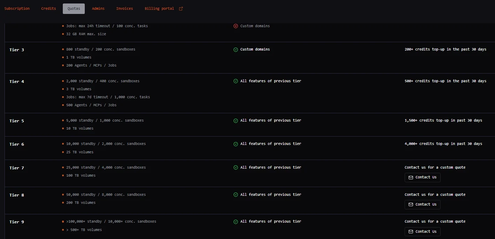
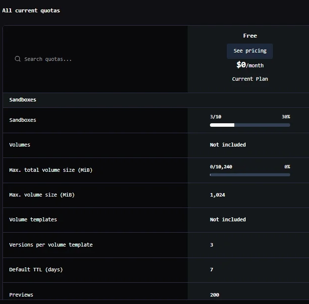
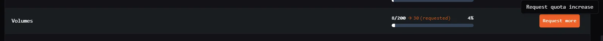
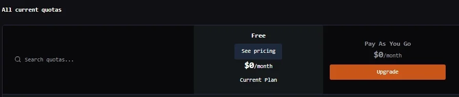
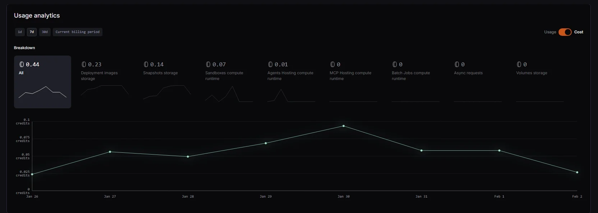

The Blaxel Console provides detailed analytics for you to monitor account usage. You can also see your account's current quotas, and request an increase in quotas if required.

## Quotas

### Quota tiers

Blaxel has a quota tiering system that unlocks higher limits and features on the platform as your tier progresses.

Higher tiers have access to higher limits such as more standby/concurrent sandboxes, more concurrent jobs, higher sandbox and volume sizes, longer sandbox TTLs. They also have access to gated features such as custom domains, dedicated IPs and more.

You can see the [limits and features of each tier](https://app.blaxel.ai/account/quotas) in the **Quotas** tab.

- Click the workspace name at the bottom left of the Blaxel Console.
- In the sub-menu, click **Account**.
- Click the **Quotas** tab.



#### How tiers are calculated

Your current tier is evaluated continuously based on your **30-day top-up volume**. This is the total amount of real funds added to your Blaxel wallet via manual or automated top-ups over the trailing 30 days.

**Top-ups are not flat fees**: Funds added to meet a tier requirement are deposited directly into your account balance. These funds are subsequently used to pay for your standard compute and storage consumption.

**Promotional credits do not unlock tiers**: Promotional credits (such as startup program grants) and previously accumulated balances automatically apply toward your active infrastructure costs. However, they do not count toward the 30-day top-up volume required to unlock or maintain a quota tier.

#### Maintaining your tier

Because tier eligibility relies on a rolling 30-day window, your tier will automatically adjust if your top-up volume decreases. If your 30-day top-up volume falls below your current tier's threshold, your workspace will be downgraded, which may result in blocked resource creation if you exceed the lower tier's limits.

To prevent service disruptions and maintain your quotas without manual intervention, you can configure **Auto top-up** in the Billing section of your Console.

#### Ephemeral volume quotas by tier

Your account can have higher quotas than its tier after a quota increase.

| Tier | Maximum size per ephemeral volume | Total ephemeral volume size |
| --- | --- | --- |
| 0 | 10 GB | 20 GB |
| 1 | 20 GB | 40 GB |
| 2 | 40 GB | 80 GB |
| 3 | 40 GB | 160 GB |
| 4 | 80 GB | 320 GB |
| 5 | 80 GB | 640 GB |
| 6 | 160 GB | 1.25 TB |
| 7 | 320 GB | 2.5 TB |
| 8 | 640 GB | 5 TB |
| 9 | 1.25 TB | 10 TB |

The total ephemeral volume size counts the ephemeral volumes of every sandbox in your account that isn't terminated, including sandboxes in standby.

#### Rate limits

These limits don't depend on your tier.

| Limit | Value | When exceeded |
| --- | --- | --- |
| Sandbox creations in progress at once, per workspace and region | 100 | 429 `WORKSPACE_RATE_LIMIT_EXCEEDED`; retry when earlier creations finish. Can be raised for a workspace on request |
| Image builds running at once, per workspace (older build path) | 10 (builds also share a platform-wide limit of 100) | No error: extra builds wait in a queue and show as building. A build that hasn't started after about 46 minutes fails. Can be raised for a workspace on request |
| Requests to `api.blaxel.ai` from one IP address | 6,000 per 60 seconds | A 403 without a JSON error body (`403 Request blocked`, or an HTML page), from the network edge rather than the API; slow down and retry after a minute |

#### Image build quotas

Blaxel is moving workspaces to a build queue. On the build queue, image builds aren't limited by a count. Your account's builds together, queued and running, may reserve up to its build quotas:

| Tier | Memory | vCPUs | Scratch disk | Default builds at once |
| --- | --- | --- | --- | --- |
| 0, 1 | 80 GB | 40 | 640 GB | 10 |
| 2, 3 | 160 GB | 80 | 1.25 TB | 20 |
| 4, 5 | 320 GB | 160 | 2.5 TB | 40 |
| 6 and up | 640 GB | 320 | 5 TB | 80 |

A default build reserves 8 GB of memory and 4 vCPUs, plus scratch disk (up to 64 GB) when its context needs it. Your account can have higher quotas than its tier after a quota increase. Builds also share a per-region limit.

- A build that doesn't fit waits in the queue, with no error, until earlier builds finish. A build still waiting after 23 hours fails.
- A build that needs more than your account's build quota on its own fails at once. Lower its sizes in the project's build configuration.
- When your queued builds reserve more than five times your build quotas, uploading a new build context (an SDK image build, or `bl deploy`) fails with HTTP 429 and a message that starts with "Too many image builds are waiting". This clears as builds finish: retry later, it is not a quota you have to raise.

Workspaces not yet on the build queue use the older limit of 10 builds at once per workspace, in the [rate limits](#rate-limits) above.

### Quota usage

Blaxel also lets you view and manage quotas associated with your account.

Quotas for your account are listed in the **All current quotas** section.



This section provides details on quotas for:

- Deployed sandboxes, agents, MCP servers, model APIs, policies, triggers, and jobs
- Sandboxes: volumes, volume templates, default TTL, previews, volume sizes and versions
- Jobs: maximum parallel executions, maximum concurrent tasks
- Workspaces: users, service accounts, integrations, custom domains, revisions, timeouts

### Read quotas through the API

You can read your account's quotas and current usage through the API, for example to size a large run or alert before it reaches a quota. This endpoint takes a user login (`bl login`) or a personal API key. A service account API key gets a `400` error, and partner platform tokens can't read it either. The older build path's limit on builds at once and the sandbox creation rate limits aren't quotas, so this endpoint doesn't list them; see [rate limits](#rate-limits).

1. Get your account ID: `GET https://api.blaxel.ai/v0/workspaces/{workspace}` returns it in `accountId`.
2. Get the quotas: `GET https://api.blaxel.ai/v0/quotas/account/{accountId}`.

```bash
# A user login (`bl login`) or a personal API key; service account keys get a 400
TOKEN=$(bl token)
WORKSPACE=my-workspace
ACCOUNT_ID=$(curl -s -H "Authorization: Bearer $TOKEN" -H "X-Blaxel-Workspace: $WORKSPACE" \
  "https://api.blaxel.ai/v0/workspaces/$WORKSPACE" | jq -r .accountId)
curl -s -H "Authorization: Bearer $TOKEN" -H "X-Blaxel-Workspace: $WORKSPACE" \
  "https://api.blaxel.ai/v0/quotas/account/$ACCOUNT_ID"
```

The response lists one entry per quota:

```json
[
  {"subjectType": "account", "subjectId": "<accountId>", "resourceType": "sandboxes", "value": 800, "used": 312},
  {"subjectType": "account", "subjectId": "<accountId>", "resourceType": "ephemeral_volume_total_max_size", "value": 163840, "used": 40960}
]
```

- `resourceType`: the quota, such as `sandboxes`, `memory`, `ephemeral_volume_max_size`, `ephemeral_volume_total_max_size`, `image_total_max_size`, `volumes` or `volume_max_size`. Sizes are in MB.
- `value`: the quota that applies to your account, including any increase.
- `used`: current usage for quotas that count or add up resources. It stays `0` for per-resource maximums such as `memory`.

Snapshots count against two quotas, both numbers of snapshots: `sandbox_snapshots`, twice your sandbox quota, and `sandbox_snapshots_per_sandbox`: 5 at tier 0, 10 at tier 1 and 20 from tier 2.

### Sandbox creation errors

When sandbox creation fails, the API returns a JSON body with a machine-readable `code`:

```json
{"code": "QUOTA_EXCEEDED", "message": "You have reached the maximum memory (32768) for your account. Requested: 65536", "status_code": 429}
```

Read `code`, not only the HTTP status: a quota error and a rate limit both return `429`, but only the rate limit goes away if you retry. The `x-should-retry` response header (`true` or `false`) and the body fields `retryable` and `retry_after` (seconds) say the same thing for clients that don't read codes.

| Code | HTTP | Retry | Meaning |
| --- | --- | --- | --- |
| `QUOTA_EXCEEDED` | 429 | No | The request would take your account over a quota. For a sandbox: its number of sandboxes, the memory or vCPUs of one sandbox, the timeout, the total ephemeral volume size or the total image storage; on `PUT /sandboxes/{name}`, also one ephemeral volume over the maximum size per ephemeral volume. Agents, functions, jobs, volumes, snapshots and the other resources return it for their own quotas too, including one job ephemeral volume over the per-volume maximum. Retrying returns the same error until you delete resources or your quota rises. Quotas on usage (number of sandboxes, total ephemeral volume size) also clear as your sandboxes end. Rather than retrying, keep the sandboxes you run at once under the quota: read it with [`GET /v0/quotas/account/{accountId}`](#quota-usage). |
| `QUOTA_EXCEEDED` | 400 | No | Sandbox create or fork only: one ephemeral volume is larger than the maximum size per ephemeral volume of your tier. Request a smaller volume. `PUT /sandboxes/{name}` and jobs return `429` for the same case. |
| `WORKSPACE_RATE_LIMIT_EXCEEDED` | 429 | Yes | Too many sandbox creations are in progress at once in the workspace and region (see [rate limits](#rate-limits)). Retry when earlier creations finish. Wait for the `Retry-After` header (5 to 10 seconds, varied per response so clients don't retry together); without it, back off exponentially. |
| `RATE_LIMIT_EXCEEDED` | 429 | Yes | Blaxel is handling too many sandbox creations in the region at the moment. Wait for the `Retry-After` header (10 to 20 seconds); without it, back off exponentially. |
| None (`code` is the number `429`) | 429 | No | A quota error from a path that doesn't return `QUOTA_EXCEEDED` yet. It may carry no retry signal; don't retry it. Today it covers an image build or registry image import that found your image storage quota full (the message starts with "Image storage quota reached"), and creating or updating a sandbox with `PUT /sandboxes/{name}` (SDK image builds do this) or unarchiving one when that goes over the number of sandboxes, the memory, the timeout or the total ephemeral volume size. Newer API versions return `QUOTA_EXCEEDED` on all of these. Job quotas keep this numeric code: concurrent tasks, the memory of running executions, and the total ephemeral volume size of a job. |
| None (`code` is the number `429`), message starts with "Too many image builds are waiting" | 429 | Yes, later | Your account's queued image builds already reserve more than five times its [build quotas](#image-build-quotas). Not a quota error, though the message links the quotas page: retry once some builds finish, with backoff. Newer API versions return the code `BUILD_QUEUE_FULL` with `x-should-retry: true` and `Retry-After`. |
| `UNAUTHORIZED`, `UNAUTHORIZED_WORKSPACE` | 403 | No | The credentials are invalid, or they don't give write access to the workspace. The body is JSON. |
| `TOKEN_REVOKED` | 401 | No | The token was revoked. Get a new one. |
| `AUTHENTICATION_UNAVAILABLE` | 503 | Yes | Blaxel couldn't verify the credentials at the moment. Retry. |
| None (no JSON error body) | 403 | Yes, after slowing down | Not a quota. The request was blocked or throttled before the API could answer it: an auth check that failed while the backend was throttled (empty body), or the network edge blocking an IP address that sent too many requests to `api.blaxel.ai` (`403 Request blocked`, or an HTML page; see [rate limits](#rate-limits)). Quota errors always have a JSON `code`. Reduce the request rate, for example by polling less often, and retry after about 60 seconds. |

See [error codes](/troubleshooting/error-codes) for the errors returned by sandboxes, agents and other workloads once they run.

### Increase account quotas

#### Automatically increase quotas via top-up

To unlock access to [higher quotas and limits](https://app.blaxel.ai/account/quotas), you must upgrade to a higher tier by topping up the appropriate amount of credit in your account. These top-up amounts go directly into your Blaxel wallet. This is not a fee for the tier itself, but rather a pre-payment for the usage you are about to run.

### Manually request a quota increase

**Upgrading to a higher tier** is the usual way to unlock higher quotas for your account. In case of issues, it is also possible to manually request an increase in quotas for your account through the Blaxel Console. To do this:

- Click the pencil icon.
- Input the requested quota value.



In some cases, you may see an **Upgrade** button instead of a pencil icon. Click this to access our payment gateway, in which you can provide details for payment.



<Note>
  Accounts on the free plan are not eligible for quota upgrades and will not see the option to request a quota increase in the Blaxel Console.
</Note>

## Best practices for quota management

### Configure sandbox TTL

Keeping inactive sandboxes in standby consumes snapshot storage and counts against your quota limits. To optimize costs and quota usage, we recommend setting a Time-To-Live (TTL) of 7 to 60 days (depending on your re-activation patterns) to automatically prune dormant sandboxes.

### Monitor usage alerts

Blaxel automatically dispatches an email notification to workspace administrators when your infrastructure usage reaches 90% of your current tier's quota.

## Analytics

Blaxel Billing Explorer provides detailed cost and usage analytics at account level. These metrics are available for the current billing period, last 30 days, last 7 days, and last 24 hours.

To view usage analytics for your account:

- Click the workspace name at the bottom left of the Blaxel Console.
- Click **Account**.
- Click the **Subscription** tab.
- Navigate to the **Usage analytics** section of the page.

The usage analytics section provides details on:

- Total compute runtime usage/cost for sandboxes, agents, batch jobs or MCP servers
- Total deployment image and snapshot storage usage/cost
- Total volume storage usage/cost
- Total number/cost of asynchronous requests

You can toggle between usage and cost metrics using the switch in the top right corner of the section.

